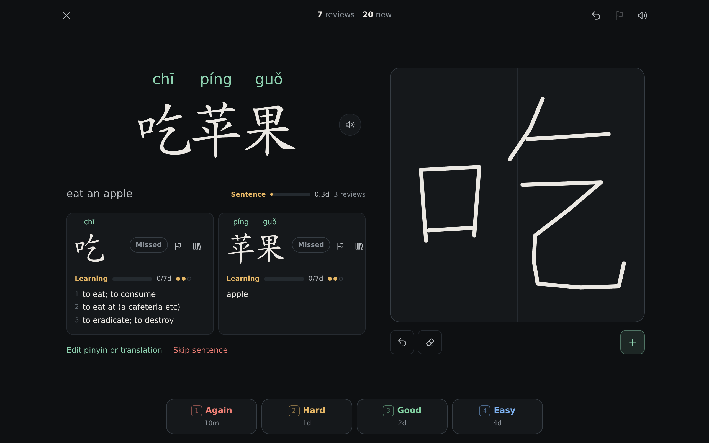
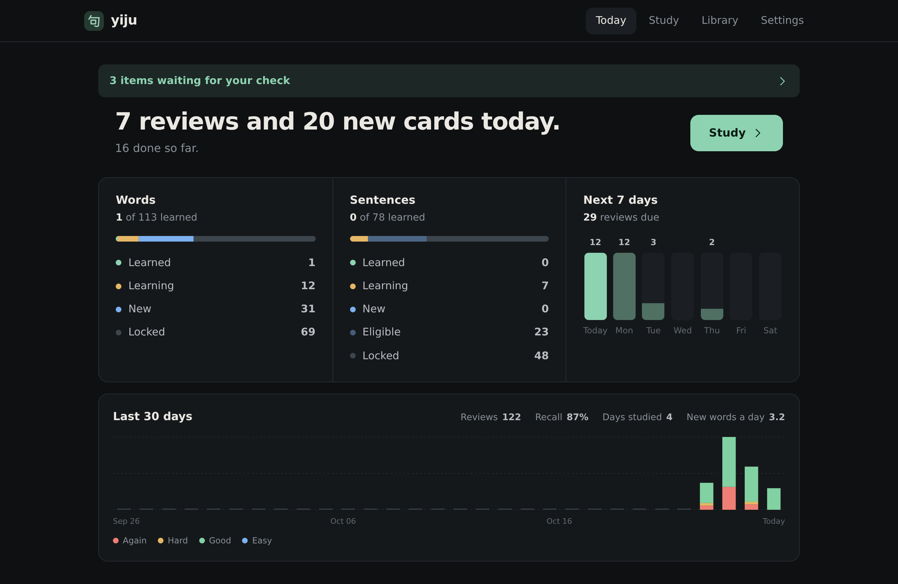
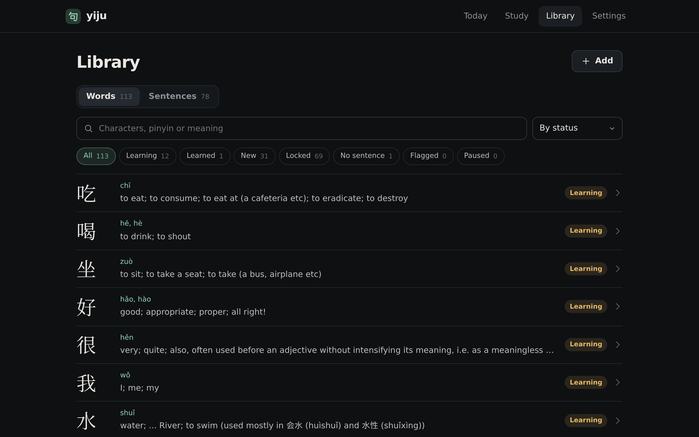
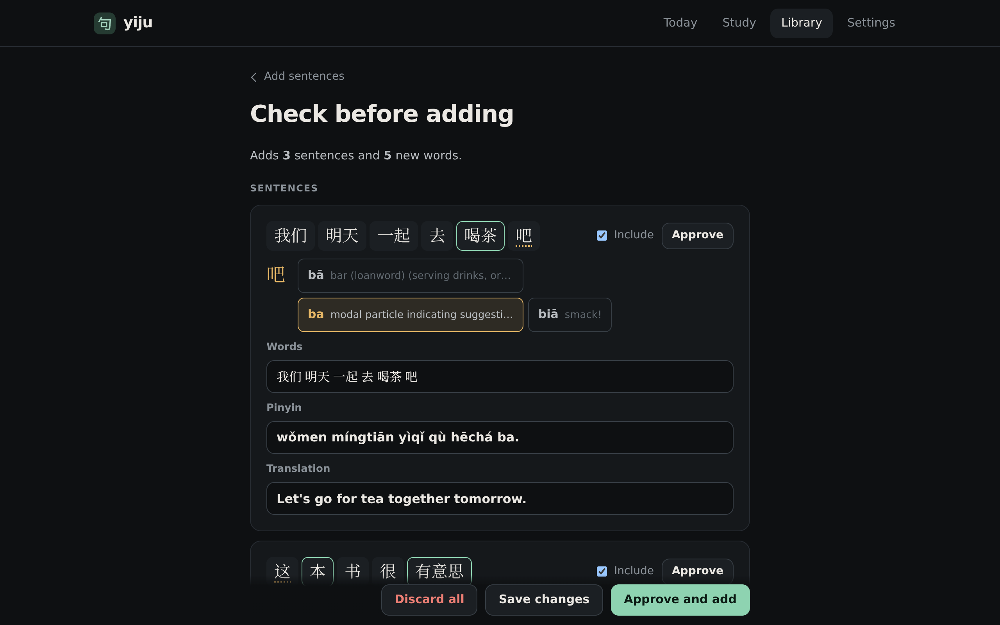

<p align="center">
  
</p>

<h1 align="center">Yiju</h1>

Yiju is a self-hosted web app for studying Chinese vocabulary through
sentences. You give it sentences. It works out which words they contain,
decides when you are ready for each one, and schedules reviews with
[FSRS](https://github.com/open-spaced-repetition/py-fsrs).

It is built for one person on their own server. There are no accounts and no
login, so keep it on a private network or put it behind something that checks
who you are.



## How it works

Words and sentences form a graph. A sentence links the words inside it.

- A word starts locked. It unlocks when it appears in a sentence where at most
  two words are not learned yet, or when you unlock it by hand from its page.
- An unlocked word becomes a pair of cards: Chinese to meaning, and meaning to
  writing the characters.
- Once you have studied every word in a sentence, the sentence unlocks and gets
  its own pair of cards.
- Review results flow back into the words. Getting a sentence right or wrong
  moves the strength of the words in it. A word counts as learned once FSRS
  expects it to stick for a week and you have recalled it on three separate
  days. Both numbers are in the settings.

So a fresh library starts small. Short sentences unlock first, studying their
words makes longer sentences reachable, and the rest of the library opens up
from there without you sorting anything.

Each day, reviews come first. New cards follow, up to a daily limit you set.
A card whose other direction you have already studied comes before a card you
have never seen.



Definitions come from CC-CEDICT and are copied into your library when a word is
added, so you can edit them. Writing cards have a scratchpad and stroke order
animations. Every card has audio.



## Adding sentences

Paste sentences on the Library page, or use the CLI. Nothing goes straight into
your library. Imports wait on a check screen where you fix the word split,
pinyin, readings and translations, then approve sentences one at a time or all
at once.



The format is one item per line:

```
我很喜欢葡萄。 | I really like grapes.
我 很 喜欢 葡萄。 | I really like grapes.
葡萄 苹果
```

Spaces inside the Chinese set the word split by hand, for when jieba gets it
wrong. A line of words with no translation adds those words without a sentence. `yiju import format` prints the
full description.

People in sentences are slots instead of names:

```
{A}给{B}一本书。 | {A} gave {B} a book.
{A}和{B}是兄弟。 | {A} and {B} are brothers. | A=male B=male
```

Every time a card is shown, study fills each slot with a random name from the
Names tab, and `{A.他}` becomes 他 or 她 to match. The optional third part sets
gender rules. You add names the same way as sentences, and they wait on the
same check screen.

### Using an agent

The CLI is meant for scripts and LLM agents, and every command except `serve`
and `backup` prints JSON. An agent can generate sentences, stage them with
`yiju import add`, and revise them with `yiju import edit-sentence` and
`yiju import edit-word`. It cannot approve them. Approving happens only in the
web app, so you see everything before it reaches your library.

These commands talk to a running server through its `/api/agent` routes, so
they work from any machine that can reach it. Pass the address with `--url` or
set `YIJU_URL`, for example `YIJU_URL=http://localhost:8000 yiju stats`.

Run `yiju --help` for the full list. It also covers reading your library,
flagged words and the review log. [docs/agent-guide.md](docs/agent-guide.md)
is a guide written for agents. Point an agent at it and it has everything it
needs to write and stage sentences and names.

## Running it

### With Nix

```sh
nix run github:ominit/yiju -- serve --port 8000
```

### On NixOS

```nix
{
  inputs.yiju.url = "github:ominit/yiju";

  outputs = {nixpkgs, yiju, ...}: {
    nixosConfigurations.server = nixpkgs.lib.nixosSystem {
      modules = [
        yiju.nixosModules.default
        {
          services.yiju = {
            enable = true;
            port = 8000;
          };
        }
      ];
    };
  };
}
```

The service keeps its data in `/var/lib/yiju`.

### With uv

```sh
uv sync --locked
uv run yiju serve
```

### Data

Everything lives in one data directory. It defaults to `data/` and can be
changed with `--data-dir` or `YIJU_DATA_DIR`. It holds the SQLite database, the
session secret, the dictionary and cached audio and stroke data.

`yiju backup FILE` copies the database while the app is running, and the
Settings page has a download button that does the same.

### Network access

The server needs internet access for three things, and caches each result in
the data directory:

- The CC-CEDICT dictionary from MDBG, downloaded on first start.
  `yiju dictionary --update` fetches a newer copy.
- Audio from Microsoft Edge's text to speech voice.
- Stroke data for Hanzi Writer from jsDelivr.

## Development

```sh
nix develop
just check
```

`just check` formats, lints, type checks and runs the tests. The browser tests
use Playwright. `nix flake check` runs the same checks in the Nix sandbox with
the locked tool versions, which is what you should trust before pushing.

## Credits

Definitions come from
[CC-CEDICT](https://www.mdbg.net/chinese/dictionary?page=cc-cedict), licensed
under CC BY-SA 4.0. Stroke order uses
[Hanzi Writer](https://hanziwriter.org) and its character data, which is derived
from the Arphic PL fonts. Segmentation uses jieba and generated pinyin uses
pypinyin.

## License

Yiju is under the [MIT License](LICENSE). The files in
`yiju/web/static/vendor` and the dictionary excerpt in `tests/cedict.u8` keep
their own licenses, which ship next to them or in their headers.
